# Home HQ

A local household dashboard for the AiMOR wall frame, built with Go, HTML templates, HTMX and SQLite. A compact left-aligned top menu sits inside one translucent surface, with a 12 px outer gap on the frame (8 px on phones) to expose the weather sky. Frame hardware work stays in the separate [photo-frame-dashboard](https://github.com/joega/photo-frame-dashboard) project.

Inspired by [Wes Bos’s photo-frame-dashboard](https://github.com/wesbos/photo-frame-dashboard/),
with navigation and Cookbook workflow adaptations from
[Kitchen Frame](https://github.com/huntsyea/kitchen-frame). Provider requests run on
the server; the frame receives assets and data from one dashboard origin.

Frame access, boot patches and kiosk setup are documented in the [hardware project](https://github.com/joega/photo-frame-dashboard). This
web server does not replace a frame’s Android kernel or establish trusted firmware.
On the PF1007L setup used here, the stock kernel remains and network access is
restricted to the dashboard endpoint. Keep per-device backups, identifiers and
signing keys outside public source control. Household databases, uploaded photos,
caches, credentials and generated binaries are also ignored by this repository.

## Screenshots

Captured at the frame’s **1024 × 600** resolution with a fictional household,
a sample location, and simulated weather, sports and media data. The cookbook
shows example saved recipes. Click any screenshot to open it at full size.

[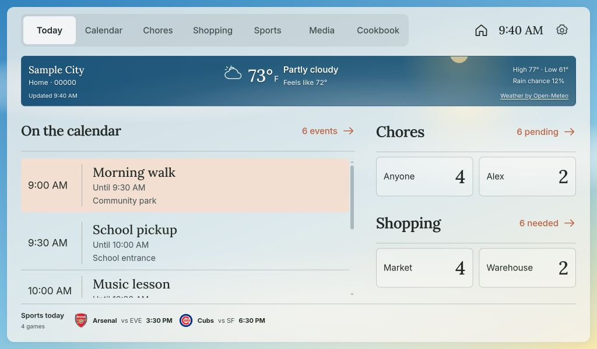](docs/screenshots/today.jpg)

| Calendar — shared day timeline | Chores — assignments and routines |
| --- | --- |
| [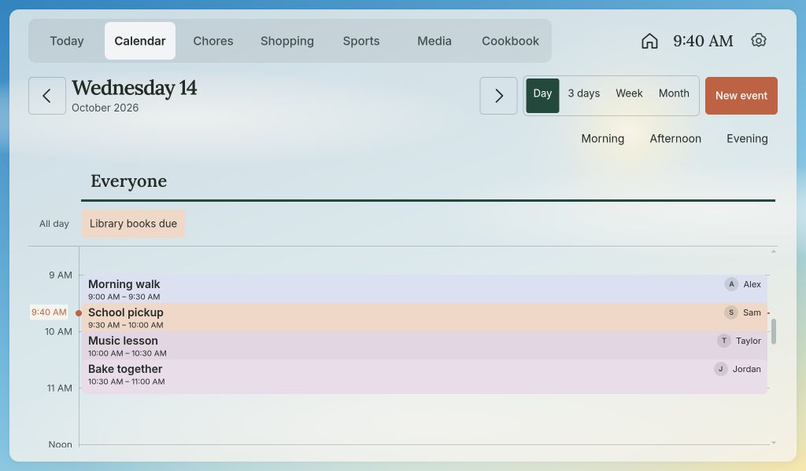](docs/screenshots/calendar-day.jpg) | [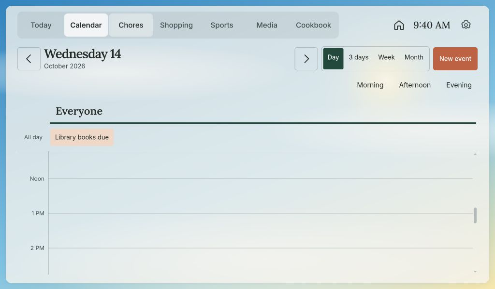](docs/screenshots/chores.jpg) |

| Shopping — stores and quantities | Cookbook — saved recipes and favorites |
| --- | --- |
| [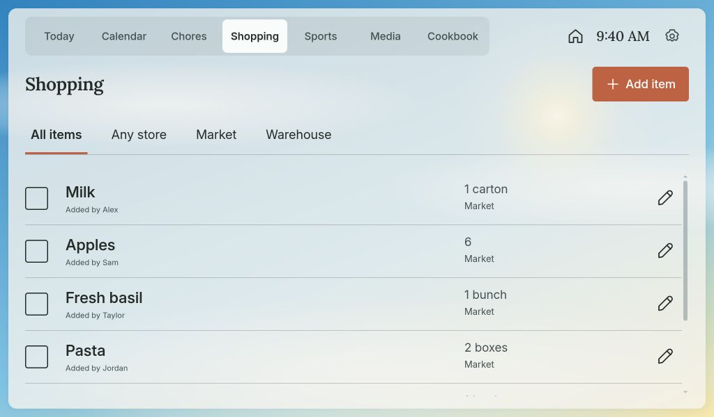](docs/screenshots/shopping.jpg) | [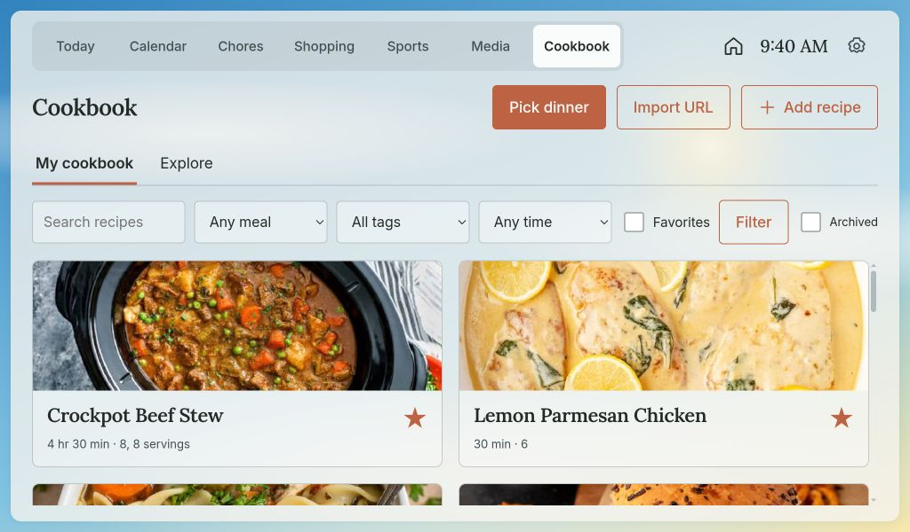](docs/screenshots/cookbook.jpg) |

| Sports — schedules across leagues | Media — music and speaker controls |
| --- | --- |
| [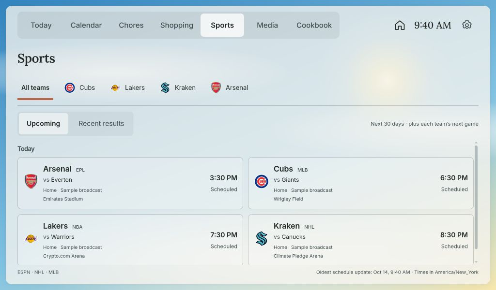](docs/screenshots/sports.jpg) | [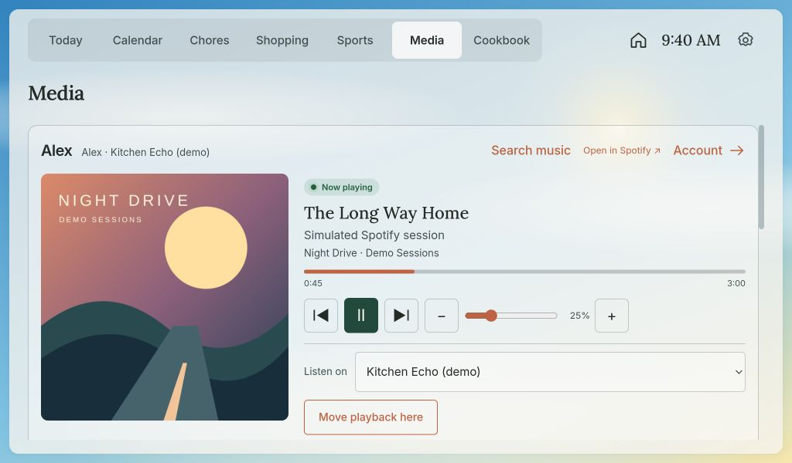](docs/screenshots/media.jpg) |

<details>
<summary>More workflows: cooking, people, recurrence, dimming, results and TV status</summary>
<table>
<thead><tr><th>Cooking mode — ingredient and step checklists</th><th>People — household profiles</th></tr></thead>
<tbody><tr>
<td><a href="docs/screenshots/cooking-mode.jpg">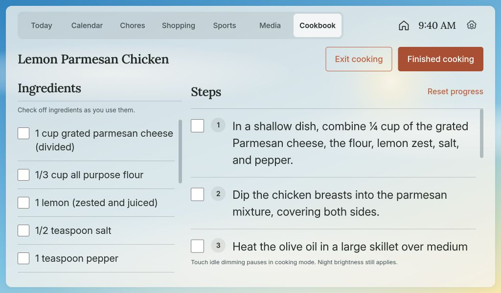</a></td>
<td><a href="docs/screenshots/people.jpg">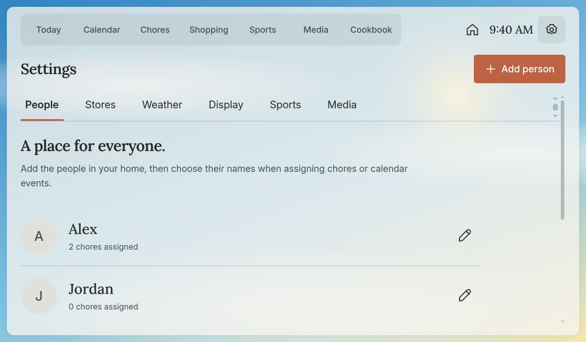</a></td>
</tr></tbody>
</table>
<table>
<thead><tr><th>Recurring events — weekday schedules</th><th>Display — night brightness schedule</th></tr></thead>
<tbody><tr>
<td><a href="docs/screenshots/recurring-events.jpg">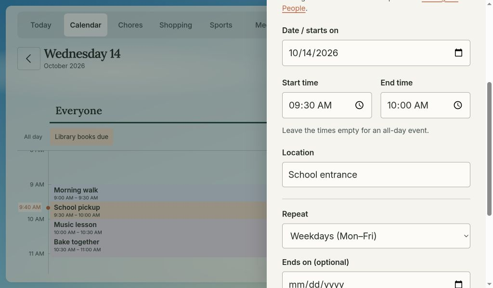</a></td>
<td><a href="docs/screenshots/night-dimming.jpg">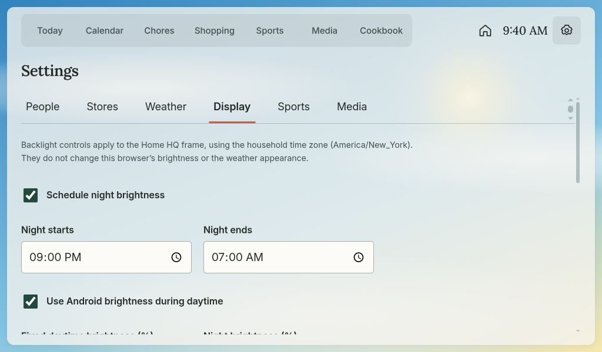</a></td>
</tr></tbody>
</table>
<table>
<thead><tr><th>Sports — recent results</th><th>Devices — TV playback and art mode</th></tr></thead>
<tbody><tr>
<td><a href="docs/screenshots/sports-results.jpg">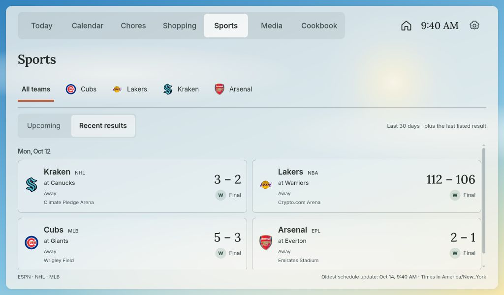</a></td>
<td><a href="docs/screenshots/devices.jpg">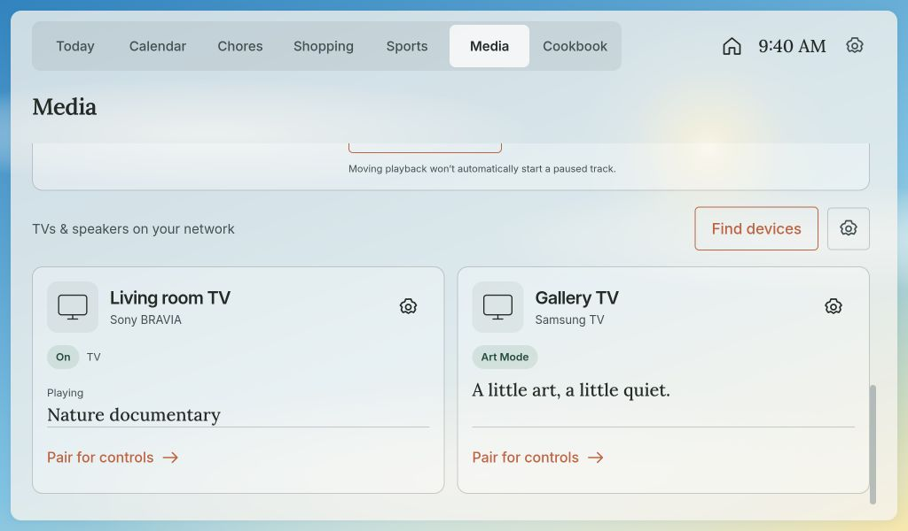</a></td>
</tr></tbody>
</table>
</details>

## Develop

Requires Go 1.26 or newer. No Node.js or Docker is needed.

```sh
go run ./cmd/home-dashboard -demo
```

Open http://127.0.0.1:4173. `-demo` seeds example data only when initializing a new database. Omit it for an empty household. The example-data footer can clear all demo events, chores, shopping and chore credit, including edits made while in demo mode (People and store settings are kept); use it before entering real data.

For a reusable binary:

```sh
go build -o bin/home-dashboard ./cmd/home-dashboard
bin/home-dashboard
```

SQLite defaults to `data/dashboard.sqlite`; entries, people, photos and completion history survive restarts. Existing free-text event/chore owners are migrated to People automatically; Anyone/Household remain unassigned choices. Static assets and time-zone data are embedded in the binary, so rebuild and restart after changing templates, CSS or JavaScript.

## Completed features

Available now; implementation details and setup instructions follow below.

- Today: compact agenda rows and two-column summary tiles for pending chores by assignee (including Anyone) and shopping by store (including Any store). Counts include every pending item, not just the first few; chores count only when due on the household date, and picked-up shopping is excluded. Only groups with pending items occupy space. Tap a tile for that person's chores or store's shopping; total links open the full lists. Home weather shows temperature, feels-like, daily high/low and precipitation chance.
- Calendar: Day with one shared household timeline and person badges, 3 days with date lanes, rolling Week agendas, Month with event dots and day drilldown. Morning, Afternoon and Evening jump through the time grid. Arrows and horizontal swipes move by the selected period. The selected view is remembered in a browser cookie.
- Calendar events: timed or all-day, optional end time, location and household member assignment. Repeat daily, weekdays, weekly, selected weekdays, monthly or yearly, with intervals of 1–99 and an optional inclusive end date. Calendar views expand a single stored series; edits and deletion apply to the entire series. Per-occurrence exceptions and edits are not yet supported. Overlap handling opens the full day agenda when necessary.
- Settings → People: persistent names, optional local JPG/PNG avatars, editing and reversible archiving. People populate chore and calendar assignment dropdowns; photos or initials also identify chore owners. Renaming keeps assignments linked. Archived people remain on existing assignments but are hidden from new ones.
- Chores: an Everyone / Anyone / person selector combines with Today, routine and All schedules views; the person choice persists while switching those views. Archived people with assignments remain filterable. One-time tasks or the same repeating schedules as events, with owner and routine filters. Today shows only due chores; All schedules lets you edit chores not due today. One-time chores remain available from their start date until completed. Recurring completion is scoped to each scheduled household date. Off-schedule chores cannot be marked complete.
- Chore completion history: records the household date, UTC timestamp, stable person ID and name/title snapshots from this version onward. Credit goes to the assigned person; the kiosk has no identity verification. Repeated completion requests do not add credit. Unchecking retracts that occurrence; renaming, archiving or deleting the chore preserves other past credit. Stable task keys prevent a reused SQLite row ID from inheriting another chore’s credit. Existing pre-history completions are not retroactively attributed or timestamped. The actual metrics/rewards screen is deferred. Schedule changes do not rewrite previously recorded credit.
- Shopping: quantities, picked-up state and configurable store assignments. The filter bar offers All items, Any store (unassigned) and configured stores. Add/edit stores in Settings → Stores; Stop & Shop, Target and Costco are initialized once as editable defaults. Renaming keeps assignments linked; archiving hides a store from new choices while retaining assigned items. New items default to the selected active store. Changing an item’s store follows its new store when viewing a filtered list. Clear picked up removes only items in the current filter (All items clears across stores).
- Notes: a shared sticky-note board in the main menu, with five muted colors, current-person authorship and an optional recipient from People. Pinned notes stay first; archive and restore keep old messages without cluttering the board. Tap a tile for its full message and editor. Edits preserve the original author, and version checks prevent an older editor from silently overwriting newer changes. Notes addressed to a person remain visible and editable by the whole household.
- Settings → Weather: five-digit US ZIP, Fahrenheit/Celsius, weather on/off and background controls. New databases start with sample ZIP 10001 (New York, NY); choose your home ZIP in Settings. Existing saved locations are preserved on updates. Static sky scenes follow live conditions and server-calculated day/night. Appearance defaults to Automatic: light between home sunrise and sunset, dark at night, with Light/Dark overrides. The sun calculation works even if weather is off or unavailable. A small local appearance refresh updates only CSS once a minute, preserving open editors and unsaved settings. This does not change the LCD backlight. Neutral paper and clearly labeled sunny/cloudy/rain/storm/snow/fog/night previews are available; previewing a scene never alters weather readings.
- Settings → Display: persistent night hours and backlight level for the native kiosk. Default 21:00–07:00 at 8%; daytime follows Android manual/adaptive brightness, with an optional fixed level. Opt-in dimming after no touch activity (default five minutes / 5%) restores on touch and never increases the current level on this frame. The server supplies time and household time zone; the kiosk caches valid settings and continues the schedule during connection loss. After an offline app restart with cached night scheduling enabled, it uses night brightness until time synchronization. These controls affect the frame, not desktop browsers. Motion wake and full screen-off remain unavailable until a real presence signal and reliable wake path are verified.
- Connection warnings: background page, clock, appearance and media polls tolerate isolated failures. Repeated failures lasting at least one minute show a retry notice; any successful dashboard request clears it. User-initiated requests report failures immediately. Automatic retries apply to background reads only; saves and media commands are never replayed automatically.
- Weather page: a top-level menu link and clickable Today weather strip open current conditions, a scrollable next-24-hours forecast and seven daily cards. Select a day for its remaining/local hours; return to Next 24 hours for a rolling outlook. Wind, sunrise/sunset, temperature units and rain/snow chance labels reuse the existing household weather cache. Repeated daylight-saving hours retain distinct zone labels. Limited coverage, missing probabilities, stale, loading, disabled and expired data are labeled explicitly. Forecast scroll positions survive background refreshes. All visuals are static; opening the page makes no extra provider requests.
- Weather foundation: one server-owned Open-Meteo request fetches current weather and seven days of hourly/daily forecasts, cached in SQLite. Successful forecasts refresh every 15 minutes; failures back off from one to 15 minutes and preserve usable cached data. Failed/late updates are labeled stale; current weather expires after two hours and falls back to an unavailable widget and neutral scene. Invalid data cannot replace the last good cache; ZIP changes isolate caches and discard late old-location writes. Page views do not fetch weather, and fresh cached forecasts survive server restarts. Inline weather settings pause periodic page refresh so edits are preserved.
- Cookbook: your own household collection comes first, with manual entry for paper recipes, optional JPG/PNG photos, notes and favorites featured ahead of other recipes. Search by title, ingredient or tag; filter by meal, tag, maximum time, favorites or archived recipes. URL and Schema.org Recipe JSON-LD imports open an editable review before saving. Explore provides secondary TheMealDB discovery; save and adapt discoveries into your own book. Cooking mode offers larger ingredients and step checklists with progress remembered in each browser; Finish records last-cooked time and clears that browser's checks. Select missing ingredients for Shopping, review names and quantities, and choose stores before transferring. Matching pending items are skipped. Archive/restore and portable JSON-LD export are included. Pick dinner chooses randomly from the current filters' saved, active Dinner recipes. The native kiosk pauses touch-inactivity dimming during cooking; the night brightness schedule still applies.
- Sports: schedules and results for any cataloged MLB, NHL, NBA, NFL, MLS or Premier League team. Settings → Sports searches by name/city/abbreviation, filters by league and saves up to 24 followed teams. The first six get horizontal shortcuts; additional teams stay available through More teams and All teams. Upcoming and Recent results show the next/last listed game across season breaks, home/away opponents, start times, final W/L/D results, venue and provider-supplied broadcasts. Unknown times are labeled TBD and missing scores stay missing. A compact Today summary shows up to two games with the total count. Schedules and PNG logos are cached on the server; there is no ticker.
- Media: local Sony BRAVIA, Samsung TV and Google Cast discovery with distinct network availability, native power and app-reported playback. Add, rename or hide devices in Settings → Media. Optional Sony pre-shared-key or Samsung on-TV approval unlocks only play, pause, volume and mute. Samsung Frame Art Mode is checked after pairing where supported. No Home Assistant is required. Per-person Spotify connections add independent player cards with now-playing artwork, progress, available Connect devices, song/album search and bounded music controls. Device restrictions and unavailable volume controls are shown explicitly.
- Fonts, scripts, sky scenes and weather data are served to the frame from the dashboard origin. The server contacts Open-Meteo for weather and changed-ZIP resolution; the frame needs no external network access. Source adaptation notices are in [THIRD_PARTY_NOTICES.md](THIRD_PARTY_NOTICES.md).

Docker/Compose packaging, server update tooling and idle client reloads are implemented. Data stays local to the server; the app has no authentication and should stay on a trusted private network. The frame's restricted network policy does not protect other clients accessing this server.

Monthly/yearly rules use the last day of a shorter month when the start day does not exist (for example, January 31 → February 28). Selected-day intervals use Monday-based weeks anchored to the start date. Recurrences retain local wall-clock times; an occurrence at a nonexistent daylight-saving time is skipped. Start and end dates are inclusive. Existing daily chores are migrated without changing their completion history.

## Household profiles

Use the person/avatar button in the top bar to choose the **current person**, or
Household for shared use. Selection is remembered separately on each browser or
frame; local preview and SSH-tunnel ports keep separate selections. Profiles are a convenience, not login accounts or access restrictions.
All household data and authorized media controls remain shared.

New events and chores default to the current person; existing assignments stay
as they are when edited. Their calendar view preference is saved on the server
and follows them when selected on another device. Weather, display schedules,
stores and other household settings remain shared.

Shopping items show who added them or picked them up. Entry creation, edits,
completion and reopening record a stable person ID, name/title snapshot and UTC
time in SQLite; recipe-to-shopping batches also record their author. Chore
completion credit belongs to whoever checks the chore off, while the assignee is
stored separately. Repeated submissions do not duplicate credit, and unchecking
removes that cycle’s credit. Household mode leaves new credit unclaimed. Earlier
rows keep their original data; unknown authors are not guessed retroactively.

Settings → Media lists a Spotify connection for each person. Connect each account
from the configured loopback browser address, using the documented SSH tunnel on
the server. After updating from the single-account version, use **Link existing
connection** to attach the saved account to its owner without logging in again.
Media shows one independent card per connected person and puts the current
person’s card first. Disconnecting one account does not disconnect anyone else.
Archiving a person hides their player and pauses polling while preserving data.

## Roadmap

Completed work is listed under [Completed features](#completed-features). The items
below are still planned or exploratory; their order does not set release priority.

### Planned

- **Chore charts and rewards:** completion totals by person and day/month/year,
  streaks and family-friendly progress displays using the existing activity history.
- **Calendar integrations:** external calendar synchronization and more robust event
  locations, followed by forecast badges for individual events.
- **Cookbook improvements:** a dinner-picker wheel, serving scaling, automatic
  ingredient merging, handwritten-recipe OCR and additional formats such as Cooklang.
- **Sports improvements:** calendar game overlays and richer game details.

### Deferred / exploratory

- **Animated weather:** first measure responsiveness and rendering cost on the
  physical frame; keep a static fallback and an off switch.
- **Home status:** optional Home Assistant-backed, status-only views of supported
  devices. Wait for a separately configured Home Assistant installation and review
  actual upstream permissions. Heating control, door unlocking and general device
  automations stay outside the plan. See the [integration boundaries](DEPLOYMENT.md#planned-home-status-integration).
- **Cooking timers and Echo announcements:** a separate, explicitly approved output
  path after the required integration is available, with a fixed speaker, bounded
  messages and quiet hours. Usable frame-speaker volume remains unconfirmed.
- **Presence-aware screen-off and wake:** needs a verified room-presence signal and
  reliable wake path. The bezel sensor has not been verified as a motion detector.
- **Games and high scores:** a possible later section using household profiles and
  per-person scores.

## Media and TV setup

Open Media to discover TVs and Google Cast devices. Discovery uses mDNS/SSDP every
five minutes, with a manual scan button; status is polled every 15 seconds and the
open dashboard refreshes about every 30 seconds. Page views read cached status.
Discovered stable identities follow DHCP address changes. Manually added Samsung
TVs are also probed for their public UPnP identity; a fallback address-only entry
needs a router DHCP reservation. Devices that stop responding show unavailable,
not a guessed power state. An off Sony can remain discoverable: native standby
wins over stale Cast app advertisements, which are then suppressed.

Playback titles depend on the app reporting a Cast media session. Native Netflix,
HDMI inputs and other TV apps may supply no title; network presence alone never
means something is playing. Samsung's public endpoint reports basic power, not
Art Mode or reliable now-playing metadata. Optional pairing permits the separate
Frame Art Mode query. Model/firmware differences may limit these APIs.

Pair only if you want controls or the protected status fields. Sony pairing uses
a pre-shared key configured on the TV's IP-control settings; a DHCP address change
requires confirming it again rather than sending the saved key to a new address.
Samsung pairing waits up to one minute for **Home HQ** approval on the TV. Controls
are limited to play/pause, relative volume steps and mute, with fresh-status and
rate guards; they are paused during confirmed standby or Art Mode. Discovery and
polling never launch apps, change inputs, send remote keys or power on a TV. Any
household dashboard user can use paired controls. Locks and heating remain outside
this feature.

Keys/tokens stay in SQLite on the server and never enter page HTML, browser storage
or Git. Protect the data volume and backups. Device-issued TLS certificates for
Cast and Samsung are pinned by public key after the first connection; changed keys
are rejected before a Samsung token is sent. This is trust on first use on your LAN,
not public-CA device authentication. Sony's local PSK API uses HTTP, so pair it only
on a trusted network. Forget pairing clears local secrets/pins; revoke Home HQ on
the TV separately to remove its stored authorization.

Docker bridge networks may not receive multicast discovery. Manual IPv4 addition
still works; [the optional Linux host-network profile](DEPLOYMENT.md#media-discovery-in-docker)
enables discovery without a Docker socket or extra capabilities. The frame itself
still contacts only the dashboard IP and port. Spotify is a separate account-based connection; no Amazon login or generic Alexa
commands are used.

### Spotify setup

Settings → Media accepts your own Spotify developer app's **Client ID**, with no
client secret. Home HQ uses Authorization Code with PKCE, a random browser-bound
state/cookie and a ten-minute, one-use login attempt. Playback reads and controls
are performed by the Go server; the frame never contacts Spotify directly or
streams audio. The approved scopes read playback/devices, currently playing content
and basic profile data, and permit music playback controls. No email, library or
playlist write scopes are requested. Every household dashboard user can use the
connected account's music controls.

1. Create a Web API app in the [Spotify Developer Dashboard](https://developer.spotify.com/dashboard).
2. Register the exact callback URL. For the laptop preview use
   `http://127.0.0.1:4182/media/spotify/callback`; for a remote dashboard server via SSH use
   `http://127.0.0.1:4184/media/spotify/callback`.
3. Save the Client ID and callback in Settings → Media. Open the dashboard at that
   callback's loopback origin before selecting Connect Spotify. Complete Spotify's
   login and approval in that same browser; switching browsers loses the login cookie.
4. Start music in Spotify/on a linked Echo if there is no active player. Home HQ
   shows only devices the API returns; it does not assume every Echo is available.

Media’s **Search music** opens song or album results with a playback-device picker.
Search runs only when submitted; select Play to start a song or the beginning of an album.
Volume supports direct changes in **5% steps**, sent when the slider is released;
the +/- buttons remain available. These features use the existing Spotify approval.

Spotify currently requires Premium for development-mode app owners and supports up
to five allowlisted authenticated accounts per app. Each public-repo adopter uses
their own developer app; Home HQ does not ship a shared Client ID. Link separate Family accounts to separate people. Each person must approve their
own connection and be allowlisted in your Spotify developer app. The app's account
limit still applies; connecting several people does not bypass Spotify's limits.
[Spotify quota documentation](https://developer.spotify.com/documentation/web-api/concepts/quota-modes).

The server checks each connected person’s playback about every 15 seconds and device availability about
every minute. Media refreshes about every 15 seconds while visible and unedited.
Automatic token refresh survives app/container restarts. Failures preserve labeled
cached information but disable controls; `Retry-After` backoff is honored on rate
limits. A Spotify API rate-limit response also pauses requests from other accounts
using the same developer app. Page views do not make Spotify API requests. Connection and polling never
start, pause, transfer or change music. Explicit controls support play/pause,
previous/next, relative volume steps and a reviewed device transfer; transfer does
not automatically resume paused playback. Restricted devices and unsupported
volume controls are disabled. Album artwork is served through the dashboard origin
without modification, credentials or arbitrary image-proxy URLs, with a link back
to Spotify.

Access/refresh tokens and pending login verifiers are stored in the private SQLite
connection table, excluded from HTML, browser storage and Git. They are included
in private database backups. Disconnect removes local tokens/pending logins and
leaves playback alone; remove Home HQ from your Spotify account's Apps page too if
you want to revoke its grant. A changed Client ID clears all connections for that old app.

The laptop preview and production server have separate databases and connections.
Test on the laptop first, then connect once on the server after deploying; do not
replace a production household database with preview data. See
[server login through SSH](DEPLOYMENT.md#spotify-login-on-the-server).

## Sports details

Sports supports all 174 current teams in the bundled MLB, NHL, NBA, NFL, MLS and
Premier League catalogs. Settings → Sports includes instant local search and a
league filter. Check a result to follow it, uncheck a followed team to remove it,
then Save sports settings. Search changes preserve unsaved selections. Follow up
to 24 teams; the first six in the saved selection order appear as shortcuts, with
a compact More dropdown at the right end of the team row for additional
selections. All teams includes every followed team. Scroll chevrons appear only
when team shortcuts or main app sections are off-screen; they reveal those items
without changing the selected page, and disappear when everything fits. Scrolled
positions survive ordinary data refreshes for the same menu selection.
The existing five Boston selections, stable keys and cached schedules survive
this upgrade. The initial Boston preset remains editable for other households.
The Today strip is labeled Sports today and follows the saved selection.
Upcoming normally covers the next 30 days, with each team's next listed game when
it falls later; Recent results covers the past 30 days, with the last listed
result when available across an off-season. A rolling schedule refresh retains a
previously cached final result if the new feed contains no finals; retained results
are labeled Cached. First-time setup cannot invent an older result absent from the
provider response. Times use the household zone; TBD dates retain the provider's
calendar date, and season-crossing dates include the year.

Go adapters adapt Sportray's team identities, schedule/status normalization,
response bounds and cache/failure policies. NFL and NBA combine ESPN's current
and regular/postseason team schedules; MLS and Premier League combine their
results and future-fixture feeds. NHL uses each club's current-season schedule;
MLB uses a bounded StatsAPI window. Provider identifiers stay separate by league:
MLB/NHL use their native IDs, and NFL/NBA/MLS/EPL use ESPN IDs. No provider
references, arbitrary URLs, alerts or betting data are exposed to the frame.

One server worker owns requests. Healthy quiet schedules revalidate at most every
six hours, with an earlier check ten minutes before a known start. In-progress
and likely playing-window games revalidate about every two minutes; repeated
failures back off from one to fifteen minutes and preserve last-good snapshots.
Browser page views never issue provider requests. Normal data refresh remains
30 seconds on the client, so live scores are informational rather than a realtime
ticker. Cached schedules older than seven days become unavailable instead of
presenting them as current. Disabled teams are not fetched.

The normalized schedule cache and followed-team PNG logo downloads persist
in SQLite across restarts. Responses are limited to 2 MiB and 256 games per team;
logos are limited to 1 MiB/1024 px and served only through the dashboard's origin,
with local initials when unavailable. Provider redirects must stay HTTPS on the
same reviewed host. Source attribution appears in Sports; provider data and team
marks are not relicensed under this application's MIT license. ESPN's site APIs
and the sports-provider feeds can change or become unavailable.

Team search uses an embedded catalog, so browsing it works without a provider
request. Only followed teams trigger schedule/logo downloads. Maintainers can
refresh league membership and branding from the primary feeds:

```sh
python3 scripts/refresh-sports-catalog.py
go test ./...
```

Review the catalog diff and provider mappings before committing and rebuilding.
This is a source-maintenance task, not a runtime dependency; Python is not needed
in the container. The refresh retains previously cataloged team keys (including
relegated EPL clubs) so it cannot silently discard saved household selections.
A changed roster size or unknown NHL mapping requires explicit maintainer review.
The catalog snapshot is dated in `internal/sports/catalog.json`.

## Frame display and audio

Automatic light/dark appearance, scheduled night backlight dimming and optional
touch-inactivity dimming are implemented. The PF1007L exposes ambient-light,
acceleration and temperature sensors, but no verified room-presence signal.
Full screen-off and motion wake remain on the deferred roadmap. Light changes or
frame acceleration must not be treated as room motion. A dark webpage alone does
not lower the LCD backlight.

A PF1007L check on October 13, 2026 found an `audiocodec` ALSA device and Android
speaker routes. A temporary native tone test completed 0.6-second and one-second
PCM playback at media levels 1/8 and 2/8, with further amplitude attenuation. The
first was inaudible; the owner possibly heard the second very faintly. AudioTrack
consumed all samples, but usable physical speaker loudness is not yet conclusively
verified. Media volume was restored to its previous value and the temporary payload
removed; no kiosk change was needed. Timer sounds remain conditional on a clearer
speaker check. Local frame sound is separate from controlling music on an Echo.

## Recipe imports and discovery

Saved recipes are local and survive provider outages. Browser cooking checklists
are device-specific and reset when recipe content changes. TheMealDB recipes do
not always supply timings or servings; missing fields are labeled rather than
inferred from the title.

[Schema.org Recipe](https://schema.org/Recipe) JSON-LD is the portable format used
for import/export. URL import reads this metadata without executing site scripts;
sites that block downloads or omit it require manual entry. Recipe text is retained
for review, so prices or preparation annotations from a source may need tidying.
Multiple recipes on a page produce a choice before editing. Export includes the
saved photo and household notes; imports accept up to 2 MB of JSON-LD.

All external downloads happen on the server. URL imports reject credentials,
private/local addresses, unexpected ports, unsafe redirects and DNS results that
include non-public addresses. Responses, images, recipe fields and caches are
bounded. JPG/PNG photos are normalized to JPEG with a maximum 640 px side and
stored locally. The frame receives pictures and provider data only from the
dashboard origin. These are practical import safeguards, not a full security audit.

[TheMealDB](https://www.themealdb.com/api.php) discovery caches results and thumbnails
for 24 hours. Set `MEALDB_API_KEY` for your provider key; the default `1` is the
provider's developer/educational test key. Recheck provider terms before public
or commercial distribution; public app-store releases require a supporter key.
The application's MIT license does not relicense recipe-provider content.

## Configuration

| Flag | Environment variable | Default |
| --- | --- | --- |
| `-addr` | `DASHBOARD_ADDR` | `127.0.0.1:4173` |
| `-db` | `DASHBOARD_DB` | `data/dashboard.sqlite` |
| `-timezone` | `DASHBOARD_TIMEZONE` | `America/New_York` |

For a LAN deployment, bind the server's private interface, for example `-addr 192.168.50.10:4173`, and configure the frame to load `http://192.168.50.10:4173/`. This is a sample address; replace it with your server's fixed LAN IP. Keep development on loopback until deployment. The server supplies the household clock, avoiding reliance on the frame's inaccurate system time.

A pinned multi-stage [Dockerfile](Dockerfile), dashboard-only [Compose stack](compose.yaml), [.env.example](.env.example) and [deployment guide](DEPLOYMENT.md) are included. Production uses Debian 13 distroless with a static non-root Go executable, persistent SQLite volume and read-only root filesystem. Local development can continue with Go. The guide covers validation, preserving existing data and moving an image without a registry.

## Automatic updates

After the optional server timer and frame version detector are installed, the normal workflow is **develop → test → commit → push to GitHub `main`**. Routine updates require no server login or manual frame reload:

1. The host systemd timer checks public GitHub `origin/main` about every **30 minutes after each run**. The interval is configurable; unchanged versions cause no rebuild or restart.
2. When main advances, the updater builds and tests while the current dashboard stays running, takes and verifies a consistent SQLite backup, and preserves the previous image/configuration for recovery.
3. It replaces only the Home HQ container and waits for health. The household data volume is preserved; Docker itself and other containers keep running.
4. Open browsers and the frame check the application version every minute, then reload the current page after **60 seconds without interaction**. Open editors, unsaved forms, ingredient review and cooking defer the reload. Failed version checks keep the current screen; saved cooking progress survives a reload.

Install once **on the Linux/systemd server**, from its configured checkout after these files are pushed:

```sh
git pull --ff-only
sudo bash scripts/install-auto-update.sh --interval 30
```

The installer creates a private managed deployment checkout and copies the server's `.env` on first installation, using the existing Compose project and data volume. Deployment access stays on the host; the web container gets no Docker socket or update permissions. Clients running the old code need **one full reload** after the detector's first deployment; subsequent updates are automatic.

For an immediate check or to inspect failures over SSH:

```sh
sudo systemctl start home-hq-update.service
sudo journalctl -u home-hq-update.service -n 60 --no-pager
```

Build/backup failures preserve the running container. Startup failures are logged with recovery instructions and need investigation; household data is never automatically restored. See [the deployment guide](DEPLOYMENT.md#optional-automatic-updates-on-linux--omarchy) for changing the interval, managed environment settings, pause/resume, logs and recovery. Without the timer, run `bash scripts/update-server.sh` as the checkout owner for a manual update.

## Backup and move

Create a consistent database snapshot, including any live WAL data:

```sh
mkdir -p backups
bin/home-dashboard -db data/dashboard.sqlite -backup backups/household.sqlite
```

The destination must not already exist. Preserve the original database before replacing it. Transfer this snapshot and the source project to the final host; build for its architecture and run with `-db` pointing to the snapshot. If copying the raw database instead, stop the server first and preserve its SQLite sidecars. Do not copy only the live main database file while the server is writing.

## Check

```sh
go test ./...
go vet ./...
node scripts/test-connection.cjs
node scripts/test-idle-update.cjs
```

Sports tests cover six-league catalogs and native provider IDs, legacy selections, overflow filters, followed-only fetching, season/fixture coverage, home/away score orientation, zero versus missing scores, TBD/time-zone/year boundaries, postponed/canceled states, off-season retained results, response/redirect bounds, single-flight caching/backoff, disabled teams, settings persistence/CSRF, HTML escaping and local image fallbacks. Cookbook tests cover draft ownership, metadata import, public-network URL guards, image bounds, editing conflicts, provider caching, duplicate saving, recipe filters, filtered picking, export and atomic/idempotent Shopping transfers. Tests also cover persistent completion, database backups, calendar modes and overlap handling, validation, CSRF and cross-origin rejection, HTML escaping, demo initialization, legacy-owner migration, person rename/archive, upload validation and completion-credit persistence, recurrence intervals/bounds/month ends/daylight saving, scheduled chores and event-location escaping, store assignment/rename/archive, shopping filters and scoped clearing, weather provider units/arrays/timestamps, ZIP matching, refresh throttling/backoff, cache restart/location isolation, stale/expired scenes, scene-preview accuracy, automatic appearance and overrides, legacy theme settings, CSS-only appearance refresh, weather settings validation, display-policy validation/persistence, clock payload and CSRF protection, pending summary totals, stable group links and chore-assignee filtering. Browser validation is also required for layout and interactions. On 2026-10-13, the owner confirmed the PF1007L displayed the deployed server over the LAN in the kitchen. Automatic client updates were verified in an isolated browser deployment, including deferred editing/cooking and preserved checklist progress; a subsequent automatic code deployment on the kitchen frame has not yet been observed. On 2026-10-13, the Today weather widget, translucent scenes and touch navigation rendered on the PF1007L over USB with Wi-Fi off. A short static-calendar sample was nearly idle and reported about 73 MiB kiosk PSS; this is a baseline snapshot, not evidence about animation or long-running performance.

Cookbook was checked in a browser at 1280×800 and 390×844, with real URL import,
manual paper-recipe entry, favorites, editing, archive/restore, filtered picking,
cooking progress across reload and store-assigned Shopping transfers using an
isolated database. The PF1007L rendered library and cooking screens over USB;
cooking stayed at 55% beyond the one-minute idle threshold, and exiting resumed
5% idle dimming. The installed kiosk is Home HQ 1.5. Actual overnight cooking and
LAN deployment have not been tested. Import sites vary, and long ingredient/step
lists scroll inside their working panes.

MIT licensed. See [LICENSE](LICENSE) and [third-party notices](THIRD_PARTY_NOTICES.md).

Vendored HTMX and fonts include their upstream licenses in `web/static/vendor/`. Design references are in `design/`; the top-navigation and inset-shell direction in `design/DESIGN.md` supersedes the earlier sidebar concepts.

The expanded Sports picker was checked at 1280×800 and 390×844 on 2026-10-14:
search and league filtering, retained selections across searches, save/reload,
six team shortcuts plus All teams, overflow selection across Upcoming/Recent
results, and no horizontal page overflow. Read-only live feeds were validated
for the Yankees, Sharks, Lakers, Cowboys, Atlanta United and Liverpool. This
expansion has not yet been checked on the physical kitchen frame.

Menu overflow controls were checked at 1280×800, 1024×600 and 390×844: the
Sports More dropdown stays at the row’s right edge, scroll chevrons reveal
clipped items in both menus, fitting menus hide their chevrons, and scroll
positions persist through the normal 30-second data refresh without navigation.

The static Weather page was checked at 1024×600 and 390×844 in the in-app browser
with simulated forecasts: Today-strip and menu navigation, selecting later days,
hourly scrolling across background refreshes, Fahrenheit/Celsius, light/dark
appearance and weather-off recovery. All seven day cards fit the normal frame-sized
view. Model tests cover limited coverage, missing probabilities, local dates and
23/25-hour DST days. The new page has not yet been checked on the physical frame.
